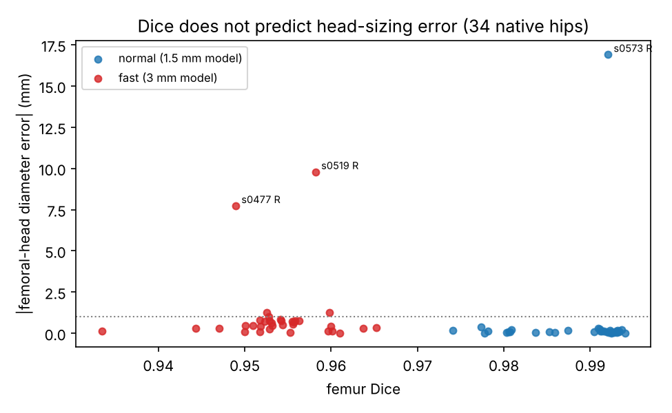
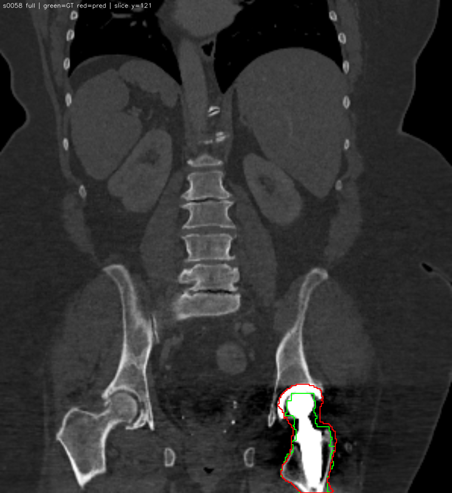
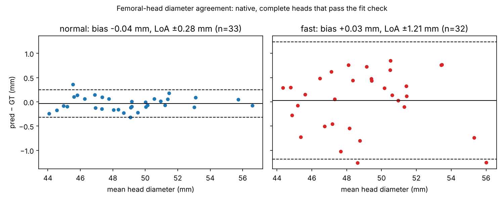

# Femur & Hip CT Segmentation: Validation and Femoral-Head Sizing

**Question.** A pretrained bone-segmentation model (TotalSegmentator, nnU-Net) is usually judged by Dice.
Does a good Dice guarantee a good **surgical measurement**? Here the measurement is the **femoral-head
diameter and centre**, which feed into hip-arthroplasty sizing and the femoral mechanical axis.

**Short answer: no.** On 20 public CTs, the low-resolution `--fast` model lowered Dice only a little,
but its boundary error was about **4× larger**. Three hips with Dice of 0.95–0.99 had **8–17 mm**
head-size errors, and 5 of 40 hips had a **metal hip replacement** that has to be detected before measuring.

> A short validation study (N = 20 CTs; 34 native femoral heads), not a clinical tool.
> Plain-language write-up: [`reports/technical_report.pdf`](reports/technical_report.pdf).
> All numbers: [`results/analysis.md`](results/analysis.md).

## Pipeline

```
CT (NIfTI) ──► TotalSegmentator (nnU-Net), roi: femur_L/R, hip_L/R
               ├─ normal model (1.5 mm)
               └─ --fast model (3 mm)
                        │
expert masks ───────────┼──► Dice · HD95 · ASSD (mm, spacing-aware)
                        ├──► marching cubes ──► STL meshes (Taubin-smoothed)
                        └──► femoral-head sphere fit:
                             femur surface within 6 mm of the hip bone
                             → least-squares sphere → refine on ±2 mm band
                             → diameter, centre (prediction vs expert mask)
quality checks: implant (metal HU) · head cut off by the scan · fit support (number of points)
```

## Data

TotalSegmentator dataset **v2.0.1, small subset** (102 CTs with expert-reviewed masks, CC BY 4.0).
Scans were kept if both femurs and both hip bones are present (at least 5,000 voxels each); 20 were used.

**Important:** this subset contains **no test-split scans** (98 train, 4 validation). The 20 scans are
18 train and 2 validation scans, which TotalSegmentator learned from. **Absolute accuracy is therefore
optimistic**; the normal-versus-fast comparison is fairer, because both models see the same scans.

## Results

### Segmentation (20 CTs, median [IQR])

| Bone | Dice normal | Dice fast | ASSD normal (mm) | ASSD fast (mm) |
|---|---|---|---|---|
| femur, left | 0.989 [0.983–0.992] | 0.953 [0.949–0.956] | 0.18 [0.15–0.31] | 0.75 [0.66–0.77] |
| femur, right | 0.991 [0.980–0.993] | 0.953 [0.952–0.956] | 0.17 [0.15–0.38] | 0.73 [0.70–0.78] |
| hip, left | 0.986 [0.984–0.989] | 0.933 [0.928–0.938] | 0.19 [0.16–0.22] | 0.77 [0.75–0.81] |
| hip, right | 0.986 [0.985–0.989] | 0.934 [0.928–0.937] | 0.20 [0.16–0.21] | 0.78 [0.76–0.83] |

All normal-vs-fast differences: paired Wilcoxon p ≤ 0.002. HD95 medians were 1.50 mm (normal) and
2.12 mm (fast) for every bone. With 1.5 mm voxels, HD95 can only take a few values, so ASSD is more informative.

### Femoral head (34 native, complete heads per model)

| | normal | fast |
|---|---|---|
| median absolute diameter error | 0.10 mm | 0.49 mm |
| median centre error | 0.17 mm | 0.72 mm |
| diameter error > 1 mm | 1 / 34 | 5 / 34 |
| gross fit failures (8–17 mm) | 1 | 2 |
| bias / 95% limits of agreement, failures removed | −0.04 / ±0.28 mm | +0.03 / ±1.21 mm |

Expert-mask head diameters averaged 48.9 mm (range 44.2–56.6 mm). Normal vs fast, paired:
|diameter error| p = 2×10⁻⁶; centre error p = 5×10⁻⁷.



**What I found.**
1. **Dice hides boundary error.** A Dice drop of about 0.04 (0.991 → 0.953) came with a 4.2× rise in typical surface error (0.18 → 0.74 mm), and about 4× wider head-size errors.
2. **Dice does not predict the measurement error** (Spearman ρ = −0.11 normal, −0.02 fast). In 3 of 68 native fits, a hip with Dice up to **0.992** gave an **8–17 mm** diameter error. These were failures of the *sphere-fitting step* (too few, or the wrong, surface points), not bad masks.
3. **The quality check I had set in advance missed them** (fit RMSE > 1.5 mm; their RMSE was 1.09–1.16 mm). A "fewer than 2,500 fit points" rule separates them perfectly here (failures: 1,347–1,959 points; every other fit: ≥ 3,314). **It was chosen after seeing the data**, so it is a hypothesis to validate, not a validated rule.
4. **Implants are common.** 5 of 40 hips had a hip replacement (more than 200 voxels above 2,500 HU next to the femur). Their "head" is a metal ball, so they were excluded from head sizing and reported separately. One more scan cut off both heads. The fast model barely saved time (median 54.0 s vs 56.6 s per CT on a T4).

<p float="left">


</p>

*Left: scan s0058, a right hip replacement (green = expert mask, red = prediction; patient's left on the viewer's left).
Right: Bland–Altman plots of head diameter, after removing the fit failures.*

## Validation of the measurement code

Before using real data, the code was checked on a synthetic phantom with a known **46.0 mm** femoral head
(anisotropic 0.8 × 0.8 × 1.5 mm voxels). The fit recovered **46.10 mm**, and the STL mesh volume matched the
voxel volume to within 0.1 % (the mesh is watertight). A fake `TotalSegmentator` (`tests/fake_bin/`) shrinks or
grows the true masks, so that the whole pipeline can run offline. The notebook's `QUICK_TEST = True` does this in about 2 minutes.

## Limitations (read before quoting any number)

- **Leakage:** all 20 scans are from the model's train/validation data, so absolute accuracy is optimistic. The full dataset's test split is the next step.
- **Ground truth is model-assisted** (iteratively corrected model predictions), so it is not independent of TotalSegmentator.
- **Rules chosen after looking:** the implant threshold, the cut-off rule and the 2,500-point fit check were set during the study (after s0058 was seen), then applied identically to every hip.
- **Small N**, one dataset; the implant rate (5/40) is not a prevalence estimate.
- **Sphere assumption:** the expert-mask fits still leave about 0.76 mm RMSE. The 6 mm and ±2 mm thresholds were not tuned.
- Most scans end at the upper femur, so femur Dice covers the visible part only. Mechanical axis / HKA and the knee are out of scope (tibia and patella are only in TotalSegmentator's licensed `appendicular_bones` task).

## Repository

| Path | What it is |
|---|---|
| `femur_ct_validation_colab.ipynb` | Runs everything in Colab (clones this repository). |
| `femur3d/` | I/O (RAS reorientation), metrics, meshes and sphere fitting. |
| `scripts/select_cases.py` | Chooses scans (all four bones present; test split first). |
| `scripts/run_totalseg.py` | Runs TotalSegmentator normal and `--fast`, logs run times. |
| `scripts/evaluate.py` | Dice / HD95 / ASSD, femoral head per side, STL export. |
| `scripts/quality_checks.py` | Implant, cut-off head, and fit-support checks. |
| `scripts/analyse.py` | Exclusions, paired statistics, `results/analysis.md`, final figures. |
| `scripts/make_figures.py` | OpenCV QC overlays, Bland–Altman, Dice boxplot. |
| `tests/` | Synthetic phantom and fake model. |
| `results/` | All CSVs, `analysis.md` and figures from the run on 19 Nov 2026 (`summary.md` is the automatic first pass, including implants). |
| `reports/technical_report.pdf` | Four-page plain-language report. |

## Reproduce

Open `femur_ct_validation_colab.ipynb` in Google Colab with a T4 GPU and choose *Run all* (about 45 minutes for 20 CTs). Or locally:

```bash
pip install -r requirements.txt
python scripts/select_cases.py DATA --n 20 --out cases.csv
python scripts/run_totalseg.py DATA cases.csv --out preds
python scripts/evaluate.py DATA cases.csv --preds preds --out results --stl
python scripts/quality_checks.py DATA cases.csv --preds preds --out results
python scripts/analyse.py results
python scripts/make_figures.py DATA --case s0058 --side right --preds preds --results results
```

## Attribution

- Wasserthal J. et al., *TotalSegmentator: Robust Segmentation of 104 Anatomic Structures in CT Images*, Radiology: AI, 2023. Model under Apache-2.0, dataset under CC BY 4.0 (the CT images in `results/figures/` come from this dataset).
- Built with an AI coding assistant, which wrote most of the code and drafted the analysis. I ran the study in Colab, reviewed the outputs, and investigated the outliers that led to the implant and fit-failure findings.
